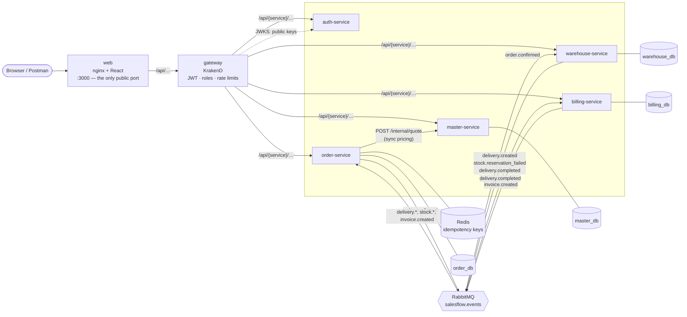
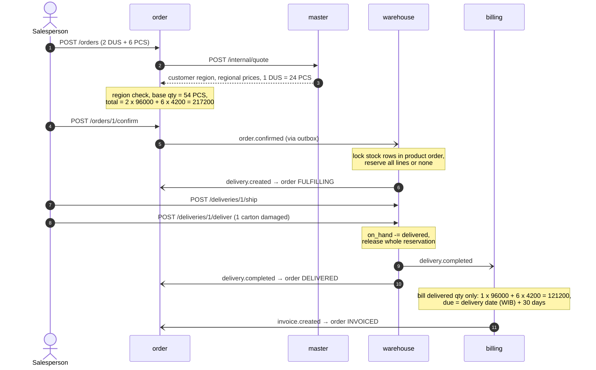
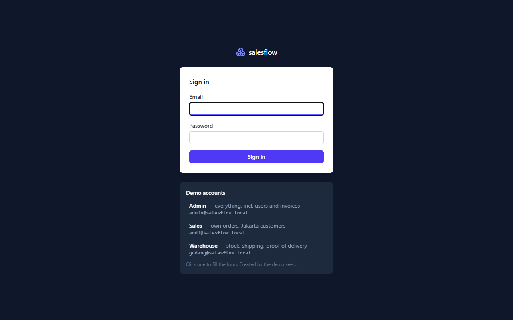
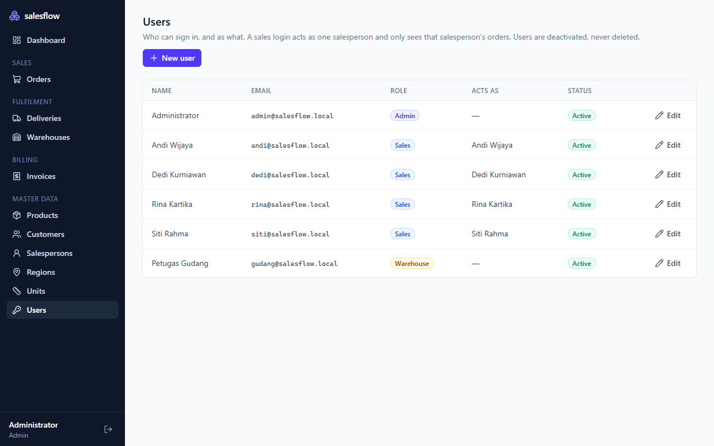

# salesflow

[](https://github.com/yugadn/salesflow/actions/workflows/ci.yml)

An order-to-cash backend for **B2B sales & distribution**, built as Go microservices. A salesperson
takes an order for a customer in their region, the regional warehouse reserves stock, the goods are
shipped and delivered, and an invoice is issued automatically for what actually arrived.

The domain mirrors the distribution systems I build at work: regional price lists, units of measure
(cartons vs pieces), stock reservation, partial deliveries and payment terms. The engineering focus
is what makes such a system trustworthy: **no lost events, no double-billing, no overselling, and no
floating-point money.** Every request passes a KrakenD gateway and carries a signed token; three
roles (admin, sales, warehouse) see and do only what their job needs. A React admin app on top lets
you run the whole flow from a browser.




| Service | Owns | Publishes | Consumes |
|---|---|---|---|
| **auth** | users, roles, token signing keys | — | — |
| **master** | regions, customers, salespersons, products, UoM conversions, regional price lists | — | — |
| **order** | sales orders and their lifecycle | `order.confirmed` | `delivery.created`, `stock.reservation_failed`, `delivery.completed`, `invoice.created` |
| **warehouse** | warehouses, stock, delivery orders | `delivery.created`, `stock.reservation_failed`, `delivery.completed` | `order.confirmed` |
| **billing** | invoices | `invoice.created` | `delivery.completed` |

Each service has its own database; none reads another's tables. Only nginx is published; the
gateway and services listen on the internal network.

## The order-to-cash flow



An order moves `DRAFT → CONFIRMED → FULFILLING → DELIVERED → INVOICED`, or ends `REJECTED` (not
enough stock) or `CANCELLED` (withdrawn as a draft).

## The admin app

| | |
|---|---|
|  |  |
| **Sign in.** Demo accounts for each role fill the form in one click. | **Users.** A sales login acts as one salesperson; users are deactivated, never deleted. |
|  |  |
| **New order.** Only salespeople covering the customer's region are offered; prices come from that region's list; `5 DUS` shows as `120 PCS`. | **Order detail.** The status timeline advances on its own as warehouse and billing events arrive. One carton was refused, so the invoice is lower than the order. |
|  |  |
| **Price matrix.** One price per region and selling unit; click a cell to change it. | **Proof of delivery.** Lower a quantity for damaged or refused goods; only what arrived is billed and the rest returns to stock. |

React 19 + TypeScript + Vite, TanStack Query for server state, Tailwind for styling. A few choices
worth noting:

- **One origin, no CORS.** The browser only ever calls `/api/<service>/…` on its own origin; nginx
  hands it to the gateway, so the backend needs no CORS configuration.
- **The UI follows the role.** Menus, buttons and pages a role cannot use are hidden, and a sales
  user's order form is locked to themselves. This is a courtesy only: the gateway and services
  enforce every rule regardless.
- **Money stays exact in the browser too.** Totals are previewed with integer cents (`bigint`), never
  floats, so the draft total always matches what the order service computes.
- **Asynchronous work is visible.** After confirming, the order page polls while an event is due
  ("Warehouse is reserving stock…") and stops once the order settles.
- **Master data screens share one component** (`CrudPage`): each page only declares its columns and
  form fields.

## Gateway, auth and idempotency

**Signed tokens, no shared secrets** ([`services/auth`](services/auth), [`pkg/auth`](pkg/auth)).
auth-service checks the password (bcrypt) and issues an 8-hour RS256 JWT carrying the user's role and,
for sales users, their salesperson. It publishes only the public key, as a JWKS. The gateway and every
service verify tokens against it, fetched lazily and refreshed when an unknown `kid` appears (at most
once per 10 s, so forged tokens cannot flood auth-service). A failed sign-in looks identical whether
the email exists, the password is wrong or the account is inactive.

**Two layers of authorization.** KrakenD rejects requests without a valid token (`401`) or with a role
an endpoint does not allow (`403`) before they reach a service; every route and its roles are listed
once in [`deploy/krakend/settings/endpoints.json`](deploy/krakend/settings/endpoints.json) and
rendered into the gateway config. Services verify the token again, because rules that depend on data
can only be checked there: a sales user can only order as themselves, and another salesperson's order
answers `404`, not `403`, so its existence does not leak.

| | admin | sales | warehouse |
|---|---|---|---|
| Master data | read, write | read | read |
| Orders | all | **own only**: create, confirm, cancel | read |
| Stock and deliveries | all | read | receive, ship, deliver |
| Invoices, users | all | — | — |

**Rate limits that cannot be spoofed.** Sign-in allows 10 attempts per minute per client. A limit
keyed on the client IP is only as good as that IP: when the gateway was published directly, rotating a
forged `X-Forwarded-For` header bypassed the limit entirely. Now nginx is the only public entry point
and overwrites `X-Real-IP` with the real peer address, and the gateway trusts that header only from
the internal network. An e2e test sends forged headers on every attempt and still expects a `429`.

**Orders are created once** ([`usecase/idempotency.go`](services/order/internal/usecase/idempotency.go)).
A salesperson on a weak connection may submit twice, or a client may resend after a timeout. With an
`Idempotency-Key`, the first request claims the key in Redis (`SET NX`, scoped to the user); a repeat
gets the same order back (`200`, `Idempotent-Replayed: true`); reusing the key for a different order
is rejected; a failed attempt frees the key for a corrected retry. If Redis is down, keyed requests
fail with `503` rather than risk a duplicate: in B2B a duplicate order is a duplicate shipment. The web
app sends one key per filled-in form.

**Known trade-offs.** The token is kept in `localStorage`, which is fine without XSS but readable by
any script on the page; an httpOnly cookie is on the roadmap, as are refresh tokens (a session lasts
one 8-hour shift). Signing keys are stored in auth's database; production would keep them in a KMS.
Deactivating a user blocks new sign-ins, but an issued token stays valid until it expires.

## Design decisions

**Transactional outbox** ([`pkg/outbox`](pkg/outbox/outbox.go)). Committing to Postgres and publishing
to RabbitMQ are two systems; doing both directly either loses an event (crash after commit) or emits
one for a change that rolled back. Services write events into an `outbox` table *in the same
transaction* as the state change, and a relay publishes committed rows with publisher confirms. Rows
are claimed with `FOR UPDATE SKIP LOCKED`, so several replicas can relay without double-publishing.

**Idempotent consumers** ([`pkg/inbox`](pkg/inbox/inbox.go)). RabbitMQ delivers at least once. Each
consumer records the event ID in `processed_events` inside the transaction that applies it, so a
redelivered event is a no-op, and a *failed* attempt rolls the mark back, so the retry still runs.
Billing adds a second guard: one invoice per delivery, enforced by a unique key.

**Retries and a dead-letter queue** ([`pkg/rabbit`](pkg/rabbit/consumer.go)). Transient failures go to
a per-service retry queue with a TTL and come back only to that service's queue, so other subscribers
never see the retry. After the retry limit, or immediately for errors that can never succeed (a
malformed payload, an illegal state transition), the message is parked in `<service>.dlq`.

**No overselling, no deadlocks** ([`warehouse` usecase](services/warehouse/internal/usecase/warehouse.go)).
Reservation is all-or-nothing: the order's quantities are summed per product, every stock row is
locked with `SELECT … ORDER BY product_id FOR UPDATE`, availability is checked, then reserved. A fixed
lock order means two concurrent orders can never wait on each other in a cycle. A `CHECK (reserved <=
on_hand)` constraint backs this up at the database level. An integration test fires 20 concurrent
orders at stock for 10 and asserts exactly 10 succeed with no deadlock.

**Money is never a float.** Amounts are `NUMERIC(18,2)` in Postgres and `shopspring/decimal` in Go
(registered with pgx), and travel as decimal strings in JSON and events. `1333.33 × 3` is `3999.99`,
not `3999.9900000000002`.

**Snapshots, not lookups.** An order freezes the customer, salesperson and price at creation time, and
events carry that snapshot downstream. Changing a price list tomorrow does not rewrite yesterday's
invoice, and warehouse and billing never call master-service.

**Events may arrive out of order.** Order status updates from events are monotonic: an
`invoice.created` that overtakes `delivery.completed` moves the order straight to `INVOICED`, and the
late event is then ignored.

**Business dates in business time.** An invoice is dated by the delivery date in `Asia/Jakarta`: a
delivery at 23:30 UTC on the 20th is invoiced on the 21st.

**Type-safe SQL.** Queries are plain SQL compiled to Go with [sqlc](https://sqlc.dev); migrations are
embedded in each binary and applied on start-up. CI fails if generated code is stale.

## Running it

Requirements: Docker, and Go 1.26+ for the tests.

```bash
make up          # build and start everything; waits until all containers are healthy
make seed        # optional: demo data (3 regions, products, customers, orders in every stage,
                 # and a login per role); then open http://localhost:3000
make e2e         # run the end-to-end suite against it
make down        # stop and delete data
```

Without `make` (e.g. on Windows), run the underlying commands:

```bash
docker compose -f deploy/docker-compose.yml up -d --build --wait
go run ./tools/seed
go test -tags e2e -count=1 -v ./e2e
```

The app and the API are both on <http://localhost:3000> (the API under `/api`). Sign in with one of:

| Email | Password | Role |
|---|---|---|
| `admin@salesflow.local` | `admin12345` | admin (created on first start) |
| `andi@salesflow.local` | `sales12345` | sales, Jakarta (created by the seed) |
| `gudang@salesflow.local` | `gudang12345` | warehouse (created by the seed) |

The services are not published; for inspection, the RabbitMQ console is at
<http://localhost:15672> (guest/guest) and PostgreSQL at `localhost:15432` (salesflow/salesflow, one
database per service).

**Frontend development** with hot reload, against the stack from `make up` (Node 22.22+); Vite
proxies `/api` to `:3000`:

```bash
cd web && npm install && npm run dev    # http://localhost:5173
```

**Try it:** import [`docs/postman/salesflow.postman_collection.json`](docs/postman/salesflow.postman_collection.json)
and run it with the Collection Runner. It signs in, seeds a region, places and confirms an order, ships
it with one damaged carton, and checks the invoice. The full API is described in
[`docs/openapi.yaml`](docs/openapi.yaml).

## Tests

| Command | What runs |
|---|---|
| `go test ./...` | Unit tests: domain rules (pricing, UoM conversion, region checks, state machine, stock movements, invoice dates), usecases against in-memory fakes including rollback behaviour, token verification (expired, wrong issuer or audience, foreign key, HS256 algorithm swap), order ownership and idempotency |
| `go test -tags integration ./...` | Plus integration tests against real PostgreSQL, RabbitMQ and Redis via [testcontainers](https://golang.testcontainers.org): outbox never publishes rolled-back events, retry/DLQ routing, concurrent reservations, one winner among 20 simultaneous idempotency claims |
| `go test -tags e2e ./e2e` | End-to-end through nginx and the gateway with real tokens: full order-to-cash, stock shortage, cross-region sale, missing price, `401`/`403` per role, sales seeing only their own orders, idempotent order creation, sign-in throttling with forged client IPs |
| `E2E_CHAOS=1 go test -tags e2e ./e2e` | Plus chaos tests: billing is stopped during delivery and still invoices once restarted; a replayed `delivery.completed` does not bill twice |
| `cd web && npm test` | Frontend unit tests: exact money arithmetic and formatting |

CI ([`.github/workflows/ci.yml`](.github/workflows/ci.yml)) runs Go lint, a `krakend check` of the
rendered gateway config, the sqlc freshness check, unit + integration tests with the race detector,
frontend lint/typecheck/test/build, and the e2e and chaos suites against docker compose, then seeds
demo data through nginx and the gateway as the administrator.

## Layout

```
pkg/                    shared by every service
  auth/                 JWT claims, signing, JWKS verification, Echo middleware and roles
  events/               the event contract: routing keys, envelope, payloads
  outbox/  inbox/       reliable publishing and idempotent consuming
  rabbit/               confirmed publisher, consumer with retry + DLQ
  db/  httpx/  apperr/  Postgres, HTTP conventions, error kinds
services/<name>/
  cmd/<name>/           main: HTTP server, outbox relay, consumer
  internal/domain/      entities and business rules, no I/O
  internal/usecase/     application logic behind repository ports
  internal/repository/  Postgres implementation (sqlc in sqlcdb/)
  internal/handler/     HTTP and event adapters
  migrations/  queries/
web/                    React admin app (Vite), served by nginx in Docker
  src/api/              typed API hooks (TanStack Query)
  src/pages/            one folder per area: orders, deliveries, warehouse, invoices, master
tools/seed/             demo data and demo logins
deploy/                 docker compose
  krakend/              gateway: endpoint list + Flexible Configuration template
e2e/                    end-to-end and chaos tests
docs/                   OpenAPI spec, Postman collection, screenshots
```

## Roadmap

- **Sessions:** refresh tokens and an httpOnly cookie instead of `localStorage`; revoke tokens on deactivation
- **Observability:** OpenTelemetry traces propagated through HTTP *and* RabbitMQ headers (one trace from order to invoice), Prometheus metrics, Grafana
- **Domain:** corporate customer groups, invoice payments including down payments, order returns and corrections
- **Shipping:** a shipping service with third-party courier adapters (rate check, pickup, AWB tracking)
- **UI tests in CI:** browser tests (Playwright) for the main flows

## Stack

**Backend:** Go · Echo · PostgreSQL · pgx · sqlc · golang-migrate · RabbitMQ · Redis · JWT (RS256,
JWKS) · bcrypt · shopspring/decimal · testify · testcontainers-go
**Frontend:** React · TypeScript · Vite · TanStack Query · React Router · Tailwind CSS · Vitest
**Delivery:** KrakenD · nginx · Docker Compose · GitHub Actions · golangci-lint · ESLint
