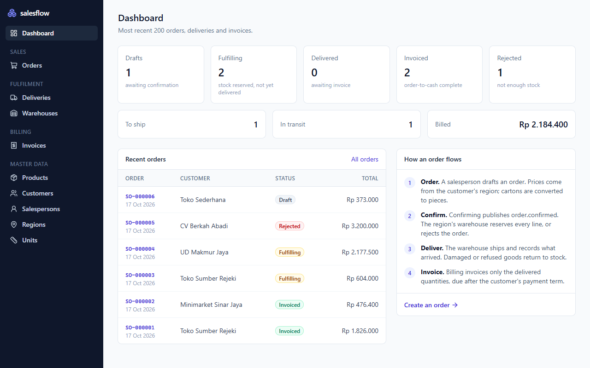
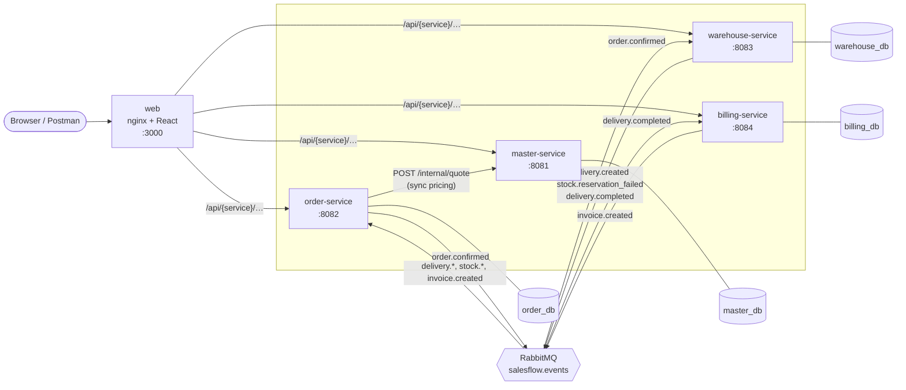
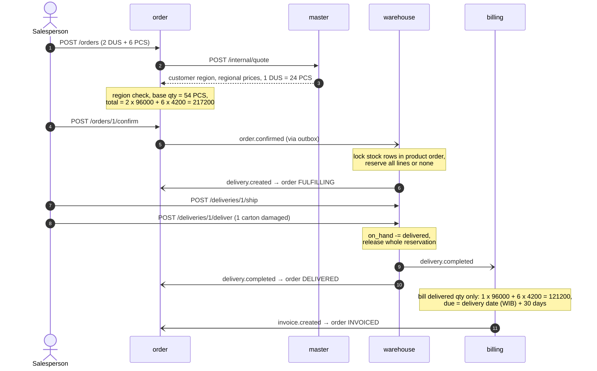
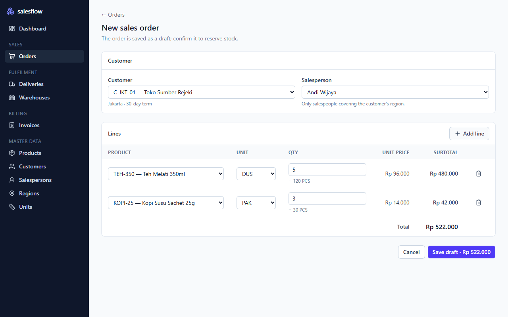
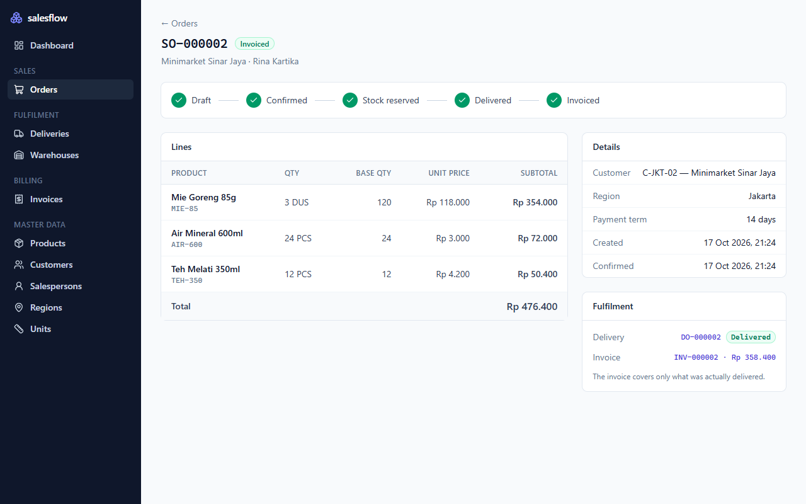
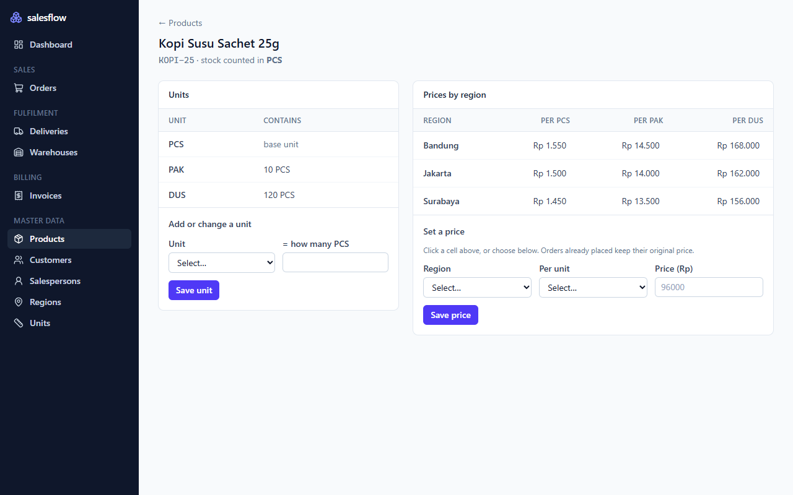
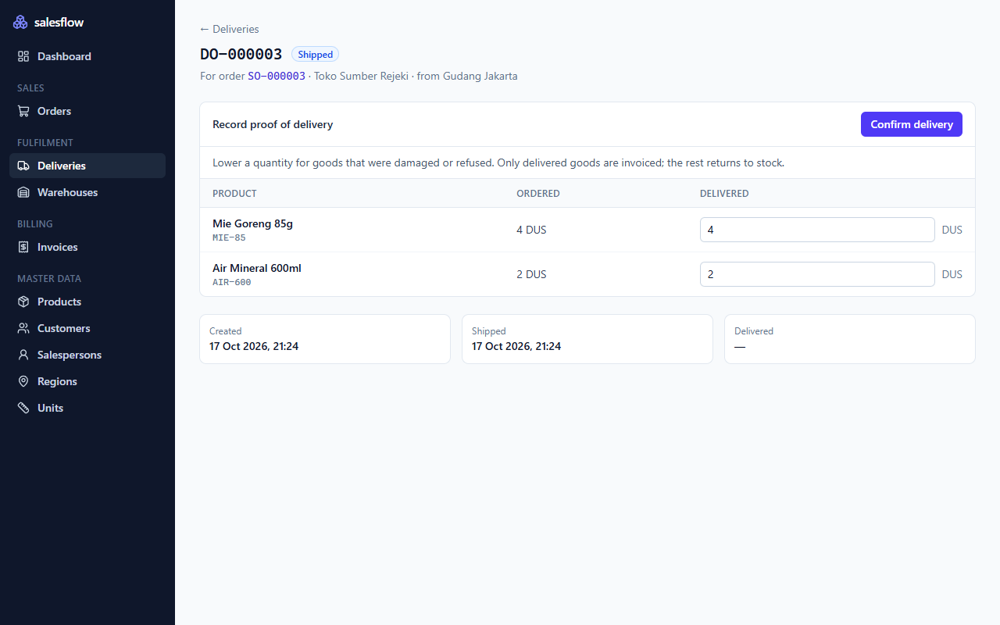

# salesflow

[](https://github.com/yugadn/salesflow/actions/workflows/ci.yml)

An order-to-cash backend for **B2B sales & distribution**, built as Go microservices. A salesperson
takes an order for a customer in their region, the regional warehouse reserves stock, the goods are
shipped and delivered, and an invoice is issued automatically for what actually arrived.

The domain mirrors the distribution systems I build at work: regional price lists, units of measure
(cartons vs pieces), stock reservation, partial deliveries and payment terms. The engineering focus
is what makes such a system trustworthy: **no lost events, no double-billing, no overselling, and no
floating-point money.** A React admin app on top lets you run the whole flow from a browser.





| Service | Owns | Publishes | Consumes |
|---|---|---|---|
| **master** | regions, customers, salespersons, products, UoM conversions, regional price lists | — | — |
| **order** | sales orders and their lifecycle | `order.confirmed` | `delivery.created`, `stock.reservation_failed`, `delivery.completed`, `invoice.created` |
| **warehouse** | warehouses, stock, delivery orders | `delivery.created`, `stock.reservation_failed`, `delivery.completed` | `order.confirmed` |
| **billing** | invoices | `invoice.created` | `delivery.completed` |

Each service has its own database; none reads another's tables.

## The order-to-cash flow



An order moves `DRAFT → CONFIRMED → FULFILLING → DELIVERED → INVOICED`, or ends `REJECTED` (not
enough stock) or `CANCELLED` (withdrawn as a draft).

## The admin app

| | |
|---|---|
|  |  |
| **New order.** Only salespeople covering the customer's region are offered; prices come from that region's list; `5 DUS` shows as `120 PCS`. | **Order detail.** The status timeline advances on its own as warehouse and billing events arrive. One carton was refused, so the invoice is lower than the order. |
|  |  |
| **Price matrix.** One price per region and selling unit; click a cell to change it. | **Proof of delivery.** Lower a quantity for damaged or refused goods; only what arrived is billed and the rest returns to stock. |

React 19 + TypeScript + Vite, TanStack Query for server state, Tailwind for styling. A few choices
worth noting:

- **One origin, no CORS.** The browser only ever calls `/api/<service>/…`. Vite's dev proxy and, in
  Docker, nginx forward each prefix to its service, so the backend needs no CORS configuration.
- **Money stays exact in the browser too.** Totals are previewed with integer cents (`bigint`), never
  floats, so the draft total always matches what the order service computes.
- **Asynchronous work is visible.** After confirming, the order page polls while an event is due
  ("Warehouse is reserving stock…") and stops once the order settles.
- **Master data screens share one component** (`CrudPage`): each page only declares its columns and
  form fields.

## Design decisions

**Transactional outbox** ([`pkg/outbox`](pkg/outbox/outbox.go)). Committing to Postgres and publishing
to RabbitMQ are two systems; doing both directly either loses an event (crash after commit) or emits
one for a change that rolled back. Services write events into an `outbox` table *in the same
transaction* as the state change, and a relay publishes committed rows with publisher confirms. Rows
are claimed with `FOR UPDATE SKIP LOCKED`, so several replicas can relay without double-publishing.

**Idempotent consumers** ([`pkg/inbox`](pkg/inbox/inbox.go)). RabbitMQ delivers at least once. Each
consumer records the event ID in `processed_events` inside the transaction that applies it, so a
redelivered event is a no-op, and a *failed* attempt rolls the mark back, so the retry still runs.
Billing adds a second guard: one invoice per delivery, enforced by a unique key.

**Retries and a dead-letter queue** ([`pkg/rabbit`](pkg/rabbit/consumer.go)). Transient failures go to
a per-service retry queue with a TTL and come back only to that service's queue, so other subscribers
never see the retry. After the retry limit, or immediately for errors that can never succeed (a
malformed payload, an illegal state transition), the message is parked in `<service>.dlq`.

**No overselling, no deadlocks** ([`warehouse` usecase](services/warehouse/internal/usecase/warehouse.go)).
Reservation is all-or-nothing: the order's quantities are summed per product, every stock row is
locked with `SELECT … ORDER BY product_id FOR UPDATE`, availability is checked, then reserved. A fixed
lock order means two concurrent orders can never wait on each other in a cycle. A `CHECK (reserved <=
on_hand)` constraint backs this up at the database level. An integration test fires 20 concurrent
orders at stock for 10 and asserts exactly 10 succeed with no deadlock.

**Money is never a float.** Amounts are `NUMERIC(18,2)` in Postgres and `shopspring/decimal` in Go
(registered with pgx), and travel as decimal strings in JSON and events. `1333.33 × 3` is `3999.99`,
not `3999.9900000000002`.

**Snapshots, not lookups.** An order freezes the customer, salesperson and price at creation time, and
events carry that snapshot downstream. Changing a price list tomorrow does not rewrite yesterday's
invoice, and warehouse and billing never call master-service.

**Events may arrive out of order.** Order status updates from events are monotonic: an
`invoice.created` that overtakes `delivery.completed` moves the order straight to `INVOICED`, and the
late event is then ignored.

**Business dates in business time.** An invoice is dated by the delivery date in `Asia/Jakarta`: a
delivery at 23:30 UTC on the 20th is invoiced on the 21st.

**Type-safe SQL.** Queries are plain SQL compiled to Go with [sqlc](https://sqlc.dev); migrations are
embedded in each binary and applied on start-up. CI fails if generated code is stale.

## Running it

Requirements: Docker, and Go 1.25+ for the tests.

```bash
make up          # build and start everything; waits until all containers are healthy
make seed        # optional: demo data (3 regions, products, customers, orders in every stage)
                 # then open http://localhost:3000
make e2e         # run the end-to-end suite against it
make down        # stop and delete data
```

Without `make` (e.g. on Windows), run the underlying commands:

```bash
docker compose -f deploy/docker-compose.yml up -d --build --wait
go run ./tools/seed
go test -tags e2e -count=1 -v ./e2e
```

The admin app is at <http://localhost:3000>. Services also listen directly on
`localhost:8081`–`8084`; the RabbitMQ console is at <http://localhost:15672> (guest/guest), and
PostgreSQL at `localhost:15432` (salesflow/salesflow, one database per service).

**Frontend development** with hot reload, against the backend from `make up` (Node 22.22+):

```bash
cd web && npm install && npm run dev    # http://localhost:5173
```

**Try it:** import [`docs/postman/salesflow.postman_collection.json`](docs/postman/salesflow.postman_collection.json)
and run it with the Collection Runner. It seeds a region, places and confirms an order, ships it with
one damaged carton, and checks the invoice. The full API is described in
[`docs/openapi.yaml`](docs/openapi.yaml).

## Tests

| Command | What runs |
|---|---|
| `go test ./...` | Unit tests: domain rules (pricing, UoM conversion, region checks, state machine, stock movements, invoice dates) and usecases against in-memory fakes, including rollback behaviour |
| `go test -tags integration ./...` | Plus integration tests against real PostgreSQL and RabbitMQ via [testcontainers](https://golang.testcontainers.org): outbox never publishes rolled-back events, retry/DLQ routing, concurrent reservations |
| `go test -tags e2e ./e2e` | End-to-end against the running stack: full order-to-cash, stock shortage, cross-region sale, missing price |
| `E2E_CHAOS=1 go test -tags e2e ./e2e` | Plus chaos tests: billing is stopped during delivery and still invoices once restarted; a replayed `delivery.completed` does not bill twice |
| `cd web && npm test` | Frontend unit tests: exact money arithmetic and formatting |

CI ([`.github/workflows/ci.yml`](.github/workflows/ci.yml)) runs Go lint, the sqlc freshness check,
unit + integration tests with the race detector, frontend lint/typecheck/test/build, and the e2e and
chaos suites against docker compose, then seeds demo data through the nginx gateway to check the
frontend container routes to every service.

## Layout

```
pkg/                    shared by every service
  events/               the event contract: routing keys, envelope, payloads
  outbox/  inbox/       reliable publishing and idempotent consuming
  rabbit/               confirmed publisher, consumer with retry + DLQ
  db/  httpx/  apperr/  Postgres, HTTP conventions, error kinds
services/<name>/
  cmd/<name>/           main: HTTP server, outbox relay, consumer
  internal/domain/      entities and business rules, no I/O
  internal/usecase/     application logic behind repository ports
  internal/repository/  Postgres implementation (sqlc in sqlcdb/)
  internal/handler/     HTTP and event adapters
  migrations/  queries/
web/                    React admin app (Vite), served by nginx in Docker
  src/api/              typed API hooks (TanStack Query)
  src/pages/            one folder per area: orders, deliveries, warehouse, invoices, master
tools/seed/             demo data loader
deploy/                 docker compose
e2e/                    end-to-end and chaos tests
docs/                   OpenAPI spec, Postman collection, screenshots
```

## Roadmap

- **Gateway and auth:** KrakenD in front of the services, JWT with admin and sales roles, Redis cache for price lookups
- **Observability:** OpenTelemetry traces propagated through HTTP *and* RabbitMQ headers (one trace from order to invoice), Prometheus metrics, Grafana
- **Domain:** corporate customer groups, invoice payments including down payments, order returns and corrections
- **Shipping:** a shipping service with third-party courier adapters (rate check, pickup, AWB tracking)
- **UI tests in CI:** browser tests (Playwright) for the main flows

## Stack

**Backend:** Go · Echo · PostgreSQL · pgx · sqlc · golang-migrate · RabbitMQ · shopspring/decimal ·
testify · testcontainers-go
**Frontend:** React · TypeScript · Vite · TanStack Query · React Router · Tailwind CSS · Vitest
**Delivery:** Docker Compose · nginx · GitHub Actions · golangci-lint · ESLint
